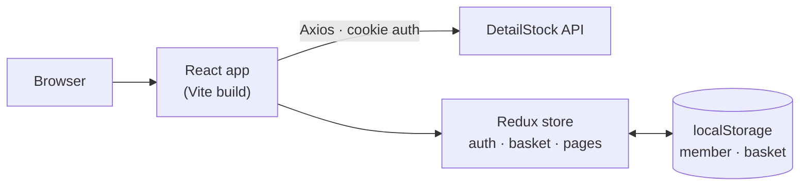

# DetailStock — Web

**React storefront for DetailStock, an online shop for professional car-detailing products — premium dark design, responsive from phone to desktop.**


**Live:** [detailstock.kr](https://detailstock.kr) · **Backend repo:** [detailStock](https://github.com/sanchezSanjar/detailStock) (Express · MongoDB)

---

## Table of contents

- [Overview](#overview)
- [Features](#features)
- [Tech stack](#tech-stack)
- [Architecture](#architecture)
- [Project structure](#project-structure)
- [Getting started](#getting-started)
- [Deployment](#deployment)
- [Author](#author)

---

## Overview

DetailStock sells polishes, pads, brushes and interior / exterior care products. This repository is the customer-facing website: browse the catalogue, fill a basket, check out and follow orders. It talks to the [DetailStock backend](https://github.com/sanchezSanjar/detailStock) over a JSON API with cookie-based login.

## Features

- **Home page** with a full-screen video hero and animated headline, live shop numbers that count up on scroll, collection tiles, product sliders with add-to-basket, a showcase video, a top-members leaderboard, event cards and an info center
- **Shop** with 7 collections, search, sorting by newest, price or views, and paging
- **Product page** with photo gallery, stock status and "add to basket"
- **Basket** that remembers its items, respects stock, and shows the delivery fee ($5 under $100, free from $100) and the real order total
- **Orders** in three tabs — paused, in process, finished — with confirm, cancel and "received" actions
- **My page** with profile editing and photo upload
- **Help page** with FAQ and notices from the admin panel
- **Login and signup**; an expired or revoked login signs the visitor out automatically

## Tech stack

| Area | Technology |
|---|---|
| Framework | React 19, TypeScript, Vite |
| State | Redux Toolkit (auth, basket, page data), persisted basket in localStorage |
| Routing | React Router 7 with lazy-loaded pages |
| UI | MUI 9, custom CSS with design tokens (dark graphite + red), Swiper sliders, Barlow Condensed + Inter fonts, scroll-reveal animations |
| Data | Axios with credentials, a 401 interceptor for expired sessions |
| Feedback | SweetAlert2 dialogs |
| Code quality | ESLint, React Compiler |

## Architecture



- **Services** (`src/app/services`) wrap every API call, so screens never build URLs themselves.
- **Slices** keep global state (logged-in member, basket) and per-page data; the basket and member survive a page reload.
- **Business rules live on the server.** Prices, stock and totals are always recalculated by the API; the website shows the same numbers so there are no surprises at checkout.

## Project structure

```
src/
├── app/
│   ├── App.tsx            routes (pages are lazy-loaded)
│   ├── store.ts           Redux store + 401 interceptor
│   ├── components/        navbar, basket, footer, product card, shared hooks
│   ├── screens/           one folder per page: homePage, productsPage, ordersPage, userPage, helpPage, loginPage, signupPage
│   ├── services/          API calls (products, members, orders, articles, stats)
│   ├── slices/            global state: auth, cart
│   └── css/               styles per area, theme tokens in app.css
└── lib/                   types, enums, config and helpers (price formatting, image URLs)
public/                    images, videos, icons
```

## Getting started

**Requirements:** Node.js 20+ and the [backend](https://github.com/sanchezSanjar/detailStock) running (default `http://localhost:3003`).

```bash
git clone https://github.com/sanchezSanjar/detailStock-react.git
cd detailStock-react
npm install
cp .env.example .env     # set VITE_API_URL to the backend address
npm run dev              # http://localhost:3000
```

| Command | Description |
|---|---|
| `npm run dev` | development server on port 3000 |
| `npm run build` | type-check and production build into `dist/` |
| `npm run preview` | preview the production build |
| `npm run lint` | ESLint |

## Deployment

`npm run build` produces static files in `dist/`, served by nginx on the production server next to the API. Set `VITE_API_URL` to the public API address (`https://api.detailstock.kr`) before building.

## Author

**Sanjar** — [github.com/sanchezSanjar](https://github.com/sanchezSanjar)
